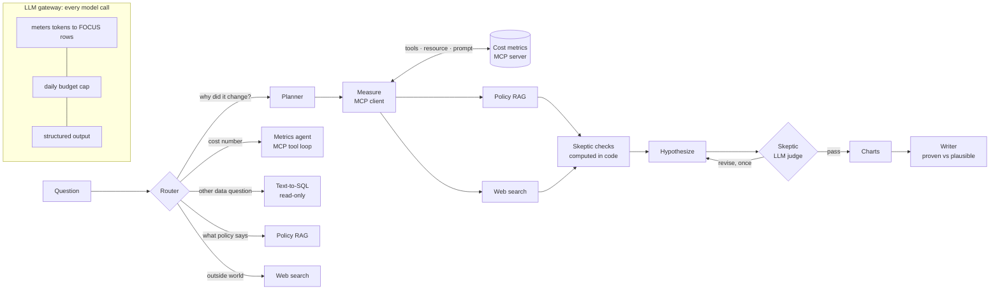

# SpendAuditor AI

**An AI analyst that audits cloud and AI bills and explains why they changed.**

Ask *"Why did our AI spend jump in March?"* and it works the way a careful FinOps analyst would:
it confirms **how big** the change is, finds **where** it is concentrated, finds **when** it started,
splits it into **usage vs price vs mix** (plus credits and one-off purchases), checks **policies and contracts**,
and then a **skeptic agent** tries to break the explanation before you see it.
The answer separates what the data **proves** from what is only **plausible**.

> In the State of FinOps 2026 survey, 98% of organisations said they now manage AI spend, and AI cost
> management was the top skill teams planned to add. AI bills are new, multi-provider and priced per token,
> and they are where cost surprises now come from.

## What it does

| Ask | Example |
|---|---|
| Why did spend change? | *Why did payments' cloud bill go up in May 2026?* → a Savings Plan expired: same usage, on-demand price (**price**, not usage) |
| Cost numbers | *Which teams were over budget in September?* |
| Policies and contracts | *Who must approve moving a production chatbot to a larger model?* |
| Anything else in the bill | *List the 5 most expensive single charge lines in 2026* (safe text-to-SQL) |
| Outside world | *Did the provider change gpt-5-mini pricing?* (web search, optional) |
| Your own bill | Upload any **FOCUS** CSV export (AWS, Azure, Google Cloud, Oracle) |

It also **watches its own AI bill**: every model call it makes is priced and logged in the same FOCUS
format, and a daily budget cap stops a public demo from running up costs.

## How it works



| Component | Job | Built on |
|---|---|---|
| Router | Picks one of 6 routes; rewrites follow-ups to stand alone | Structured output (Pydantic) |
| Cost metrics **MCP server** | Governed metrics as **tools**, a catalogue **resource**, an investigation-recipe **prompt** | `mcp` (MCPServer, stdio) |
| Investigation workflow | plan → measure → evidence (parallel) → checks → hypothesize → skeptic ⟲ → chart → write | LangGraph |
| Usage/price/mix split | Decomposes any change exactly into volume, mix, rate, credits, one-offs | Code (`metrics.py`) |
| **Skeptic** | Deterministic checks + an LLM judge that rejects claims the numbers don't support | `skeptic.py` |
| Metrics agent | Answers cost questions with an MCP tool-use loop (tools discovered, not hard-coded) | MCP client |
| Policy RAG | Tagging, budget, AI-model and commitment policies, FOCUS glossary | Chroma embeddings, BM25 fallback |
| Text-to-SQL | Questions outside the governed metrics | Read-only SQLite, 3 safety layers |
| Web agent | Provider price changes, model news | Claude's server-side web search (off by default) |
| **LLM gateway** | Meters every call into FOCUS rows, enforces a daily budget, validates structured output | `llm.py` |
| Charts | Daily spend with change start and events marked; what-made-up-the-change bars | Vega-Lite specs built in code |

## The skeptic: the classic false alarms in cost analysis

| Check | Question it settles | Example it catches |
|---|---|---|
| Usage or price? | Did we use more, or does each unit cost more? | A discount ended: same EC2 hours, +23% cost |
| Mix | Did usage shift to pricier items? | Chatbot moved to a bigger model: tokens flat, cost ×2.8 |
| One-off or trend? | A single purchase, a short burst, a level shift, or steady growth? | An annual support prepayment is not an anomaly |
| Credits | Did a credit end? | The bill rose with no change in usage |
| Timing | Did the proposed cause come **before** the change? | A campaign that launched *after* the spike is a decoy |
| Concentration | Does the named segment explain most of it? | A "cause" worth 10% of the change is a contributor |

The checks are **computed in code**; the LLM judge only decides whether the explanation's words match them.

## Data: five layers, each labelled honestly

| Layer | Source | Real or synthetic | Used for |
|---|---|---|---|
| 1. Real bill sample | FinOps Foundation [FOCUS sample data](https://github.com/FinOps-Open-Cost-and-Usage-Spec/FOCUS-Sample-Data) (10,000 rows, Sep 2024, CC BY 4.0) | **Real** (anonymized) | Account names, regions and tag style; uploadable; queryable as `real_sample` |
| 2. 15 months of company history | `scripts/generate_history.py`, FOCUS 1.3 shape + `x_Model` / `x_TokenType` | **Synthetic**, with **planted events** | The investigations |
| 3. The app's own AI spend | The LLM gateway, live | **Real** | "What did this app spend today?" |
| 4. Prices | [LiteLLM price file](https://github.com/BerriAI/litellm) (MIT) | **Real** list prices | Token costs, gateway metering |
| 5. Policies and contracts | `data/policies/` | Written for this project | RAG and the skeptic's evidence |

**Why synthetic history:** no public dataset has multi-month bills with AI token costs; the real FOCUS
sample covers one month. **Why that's an advantage:** the causes are planted on purpose, so
[`data/answer_key.json`](data/answer_key.json) knows the true answer to every investigation, which makes
a real accuracy eval possible.

| Planted event | Date | True driver |
|---|---|---|
| E1 support-ai switches its chatbot from Haiku to Sonnet | 2026-03-03 | mix |
| E2 payments' Savings Plan expires | 2026-05-01 | price |
| E3 annual AWS Business Support prepayment ($48k) | 2026-06-15 | one-off |
| E4 8 untagged GPU instances left running | 2026-07-08 → 07-29 | usage (unallocated) |
| E5 search launch (+45% tokens) masked by a 20% price cut | 2026-08-01 | usage |
| E6 Google Cloud startup credits end | 2026-09-01 | credit |
| E7 batch-job retry storm (decoy: campaign launched *after*) | 2026-09-10 → 09-14 | usage |
| T1 S3 storage grows ~4% a month | all year | trend |

**AI token columns ahead of the standard:** FOCUS up to 1.4 has no model or token-type columns. The
standard allows custom `x_` columns, so the bill carries `x_Model` and `x_TokenType`.

## Design decisions

- **A workflow, not a free-roaming agent.** A cost investigation always needs the same evidence, so the
  steps are fixed and the model's freedom is inside each step. Cost and latency are predictable and a
  failure is easy to locate.
- **Numbers come from code, words from the model.** Every figure is computed by governed metrics; models
  plan, explain and critique. A model cannot invent a number or quietly redefine "cost".
- **Metrics defined once, behind MCP.** Agents never write SQL for governed numbers. Names are
  whitelisted, values bound as parameters. Any MCP host (e.g. Claude Desktop) gets the same definitions.
- **Usage vs price vs mix is exact arithmetic.** The three effects add up to the usage change exactly
  (tested), so the skeptic argues from facts, not impressions.
- **Parallel where independent.** Policy search and web search depend only on the measurements, so they
  run concurrently (LangGraph fan-out / fan-in).
- **One revision, then stop.** If the skeptic rejects a claim, the explanation is redrafted once. A second
  disagreement is shown to the user rather than looped on.
- **Lenient allocation, strict compliance.** `env` instead of `environment` still finds the owner (spend
  isn't lost to "unallocated"), but is still reported as a tagging-policy breach.
- **The app is its own FinOps customer.** An LLM gateway meters every call into FOCUS rows and enforces a
  daily budget: the same discipline the app recommends.
- **Defence in depth for SQL.** Static checks, a read-only connection, an SQLite authorizer limited to
  whitelisted tables, row caps and timeouts. Any single layer can fail without data being changed.

## Evaluation

**Offline tests** (`pytest`, no API key): safety layers, every planted event recovered by the metrics,
the split adding up exactly, the full workflow with stubbed models (including the skeptic's revision loop),
gateway metering and the budget cap, and uploading the real FOCUS sample.

**Routing eval** (`eval/route_eval.py`): 20 frozen questions, accuracy, per-route recall, misroutes and
unstable questions. *When a route is wrong, the router gets fixed, never the test.*

**Investigation eval** (`eval/investigation_eval.py`): 7 planted scenarios scored against the answer key:
right driver, right segment, decoy not accepted, how often the skeptic intervened, cost per investigation.

| Run | Routing accuracy | Driver correct | Segment correct | Skeptic revised | Cost / investigation |
|---|---|---|---|---|---|
| Baseline (Haiku) | _to fill_ | _to fill_ | _to fill_ | _to fill_ | _to fill_ |

## Run it

Needs **Python 3.11+** (the Anthropic SDK, MCP 2.x and pandas 3 don't support older versions; macOS ships 3.9).
The easiest way is [uv](https://docs.astral.sh/uv/), which downloads the right Python for this project only:

```bash
curl -LsSf https://astral.sh/uv/install.sh | sh        # once; then open a new terminal
uv venv --python 3.12 && source .venv/bin/activate      # Windows: .venv\Scripts\activate
uv pip install -r requirements.txt
cp .env.example .env                                     # add ANTHROPIC_API_KEY

python scripts/fetch_data.py         # real FOCUS sample + LiteLLM prices -> data/raw/
python scripts/generate_history.py   # synthetic history + answer key + budgets
python scripts/build_db.py           # -> data/spendauditor.db

python -m pytest -q                  # offline, no API key needed
streamlit run app.py

python eval/route_eval.py --repeat 3
python eval/investigation_eval.py
```

**Use the metrics from Claude Desktop:** add the `mcpServers` entry from the top of `mcp_server.py` to
`claude_desktop_config.json` (with absolute paths), then ask Claude about the bill directly.

## Cost

With Claude Haiku (the default), a full investigation is about 6–8 model calls, typically **about one cent**;
a routing eval run is about $0.02. Web search adds $0.01 per search, so it is off by default
(`SPENDAUDITOR_WEB_SEARCH=true` to enable). The app enforces `SPENDAUDITOR_DAILY_BUDGET_USD` (default $1).

## Limitations

- The company history is synthetic (clearly labelled); cloud unit prices are typical public prices,
  rounded. The gpt-5-mini price cut in E5 is a synthetic event.
- Savings Plans are modelled as discounted effective cost on covered usage, without separate
  commitment-fee rows.
- Correlation is not causation: causes are marked *plausible* unless the data shows them directly.
- Uploaded bills are analysed per session on one server; a multi-user deployment would need per-user storage.
- Token cost metering prices cached input tokens at the full input rate (slight over-estimate).

## Data and licences

- FOCUS sample data © FinOps Foundation, [CC BY 4.0](https://github.com/FinOps-Open-Cost-and-Usage-Spec/FOCUS-Sample-Data/blob/main/license.md).
  Not committed here: `scripts/fetch_data.py` downloads it.
- LiteLLM model price file, MIT licence. Downloaded by `scripts/fetch_data.py`.
- Policies and the glossary in `data/policies/` were written for this project. The glossary summarises
  the public FOCUS specification in plain language.
